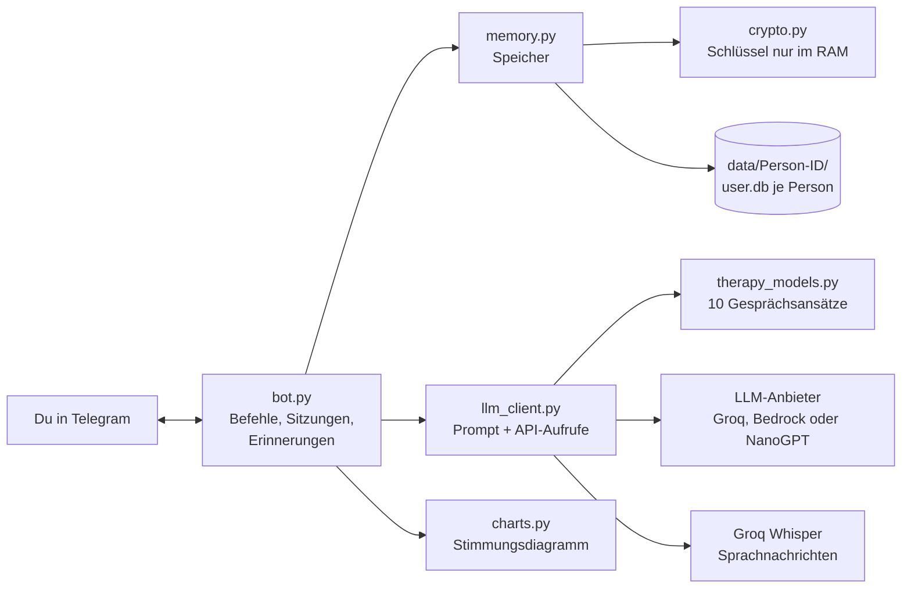
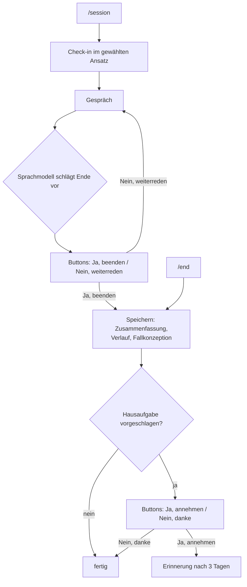
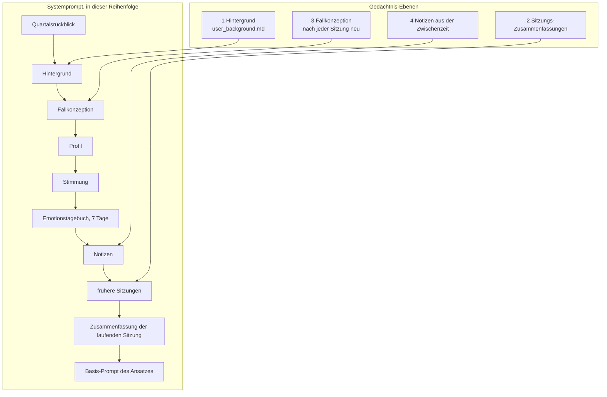
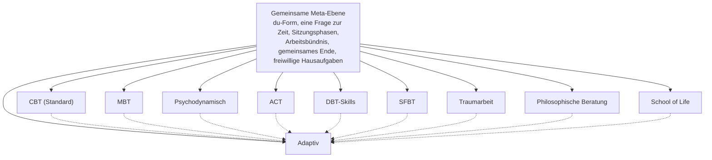
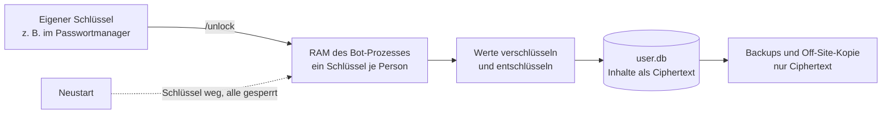

# Reflexions-Begleiter – ein Telegram-Bot für strukturierte Selbstreflexion

Ein persönlicher Telegram-Bot, der Gespräche zur Selbstreflexion führt, sich über Sitzungen hinweg erinnert und nichts Wichtiges ohne deine ausdrückliche Zustimmung festschreibt. Standardmäßig orientiert sich die Gesprächsführung an Methoden der kognitiven Verhaltenstherapie (CBT); insgesamt stehen zehn Gesprächsansätze zur Auswahl (siehe [Gesprächsansätze](#gesprächsansätze)).

**Was der Bot ist – und was nicht:** Er ist eine Hilfe zum strukturierten Nachdenken über dich selbst. Er ist keine Therapie, stellt keine Diagnosen, behandelt nichts und ersetzt keine professionelle Hilfe (siehe [Hinweis](#hinweis)).

**Kein Produkt:** Das hier ist ein privates Projekt, das ich öffentlich zeige – es wird nicht verkauft, nicht als Dienst betrieben und nicht betreut. Wer mag, kann das Repository herunterladen, selbst aufsetzen und damit experimentieren; das geschieht auf eigene Verantwortung.

## Wofür

Für Menschen, die regelmäßig und strukturiert über sich nachdenken möchten – statt eines Tagebuchs oder einfach für sich.

- **Sitzungen mit Gedächtnis:** Jede Sitzung baut auf den vorherigen auf – Hintergrund, Zusammenfassungen, eine fortgeschriebene Fallkonzeptualisierung und Gedanken aus der Zwischenzeit fließen ein.
- **Zehn Gesprächsansätze, eine gemeinsame Grundlage:** angelehnt an CBT, MBT, psychodynamische Ansätze, ACT, DBT-Skills, SFBT, Traumarbeit, philosophische Beratung und den Stil von School of Life, dazu ein adaptiver Ansatz, der sich bei den anderen neun bedient. Zu jedem Ansatz gibt es ein Grundlagen-Dokument, das beschreibt, woran sich die Gesprächsführung orientiert.
- **Nichts Wichtiges ohne Zustimmung:** Das Sprachmodell kann ein Sitzungsende nur *vorschlagen*. Gespeichert wird erst nach „Ja, beenden“; eine Hausaufgabe gilt erst nach „Ja, annehmen“ als vereinbart – das prüft der Code, nicht der Prompt.
- **Verschlüsselt pro Person:** Jede Person hat einen eigenen Schlüssel, der nur im Arbeitsspeicher liegt. Nach jedem Neustart sind alle Daten gesperrt, bis die jeweilige Person sich mit `/unlock` entsperrt.
- **Begleitung zwischen den Sitzungen:** Stimmungsprotokoll mit Verlaufsdiagramm, Emotionstagebuch, Sprachnachrichten, Erinnerungen und automatische Wochen-/Monats-/Jahresrückblicke.

**Nachweise:** über 500 automatische Tests, die ohne Netz und ohne API-Schlüssel laufen (Speicher, Verschlüsselung, Diagramme, Befehls-Registry, Telegram-Handler, Sitzungsende-Bestätigung, Simulator); 10 Gesprächsansätze mit 11 Grundlagen-Dokumenten unter `docs/` (eines je Ansatz plus eines für die gemeinsame Meta-Ebene); ein Simulator mit fiktiven Personas, der den echten Bot-Code gegen gefälschtes Telegram treibt – im Live-Lauf der Zustimmungs-Prüfungen bestanden **22 von 22 Prüfungen in 6 Szenarien** (Einordnung unter [Grenzen](#grenzen-und-stand-der-prüfung)).

![Fiktive Beispielsitzung im Telegram-Stil, zwei Spalten. Links: Check-in und Gespräch – der Bot fragt nach der Woche, die fiktive Persona Tom erzählt knapp von Stress mit seiner Partnerin Lea, der Bot fragt nach dem Gedanken dahinter und nach Gegenbelegen. Rechts: Der Bot schlägt vor, die Sitzung zu beenden, und fragt mit den Buttons „Ja, beenden“ und „Nein, weiterreden“ nach; danach folgen die Zusammenfassung (Thema, Erkenntnis, Hausaufgabe, nächste Sitzung) und die Rückfrage „Möchtest du die vorgeschlagene Hausaufgabe annehmen?“ mit den Buttons „Ja, annehmen“ und „Nein, danke“.](docs/img/chat-session.png)

*Nachgestelltes Beispiel mit der fiktiven Test-Persona „Tom“. Rückfragen, Buttons und das Format der Zusammenfassung entsprechen dem Wortlaut im Bot.*

---

## So sieht's aus

`/progress` zeigt neben Sitzungsanzahl, Themen und Hausaufgaben den Stimmungsverlauf der letzten 90 Tage aus den `/mood`-Einträgen:


*Erzeugt mit der echten Diagrammfunktion des Bots (`charts.render_mood_chart`) aus einer synthetischen Stimmungsreihe.*

---

## So funktioniert es

### Bausteine und Datenfluss



| Modul | Aufgabe |
|---|---|
| `bot.py` | alle Telegram-Handler, Onboarding, Sitzungsablauf, Zustimmungs-Buttons, Erinnerungen (APScheduler) |
| `memory.py` | sämtlicher Festplattenzugriff: eine SQLite-Datenbank pro Person, Backups, Rückblicke – ohne Telegram- oder LLM-Wissen |
| `crypto.py` | Fernet-Verschlüsselung; Schlüssel pro Person, nur im Arbeitsspeicher |
| `llm_client.py` | Systemprompt zusammensetzen, LLM-Aufrufe (Groq, AWS Bedrock oder NanoGPT), Transkription, Tagesbudget |
| `therapy_models.py` | deklaratives Verzeichnis der zehn Gesprächsansätze – reine Daten, kein I/O |
| `charts.py` | Stimmungsdiagramm für `/progress` (matplotlib) |
| `sim/` | Simulator: gefälschtes Telegram, gefälschte Uhr, fiktive Personas; treibt den echten Bot-Code |

Ausführliche Entwickler-Dokumentation (Sitzungsablauf, Designentscheidungen, Umgebungsvariablen): `docs/architecture.md`.

### Sitzungsablauf mit Zustimmungsstellen



Wichtig daran: Ein Werkzeugaufruf des Sprachmodells (`propose_end_session`) ist nur ein Vorschlag und schreibt nichts. Erst der Button-Druck löst das unumkehrbare Speichern aus. Eine vorgeschlagene Hausaufgabe wird als „nicht angenommen“ gespeichert, bis du sie annimmst – nur dann gibt es eine Erinnerung. Wer `/end` schreibt, hat das Ende bereits selbst verlangt; dort entfällt die erste Rückfrage. Bleibt eine Sitzung liegen, fragt der Bot nach 1 Stunde nach und bietet nach 24 Stunden an, sie zu beenden – dabei wird gespeichert, was es zu speichern gibt.

### Gedächtnis und Reihenfolge im Prompt



Alle Ebenen werden zu Sitzungsbeginn **einmal** geladen und nicht bei jeder Nachricht neu gelesen. Leere Abschnitte entfallen. Vollständige Verläufe und die Wochen-/Monats-/Jahresrückblicke landen bewusst **nicht** im Prompt – sie sind nur über `/export` und `/journal` abrufbar. Bei langen Sitzungen wird Älteres als die letzten 20 Verlaufseinträge zusammengefasst statt abgeschnitten.

### Zehn Gesprächsansätze, eine Meta-Ebene



Jeder Ansatz ergänzt die Meta-Ebene nur um seine Rolle, Methoden, den Fokus des Check-ins und die Form seiner Fallkonzeption. Der adaptive Ansatz hat keine eigenen Techniken: Sein Werkzeugkasten wird beim Start aus den Methoden der neun anderen Ansätze zusammengesetzt (gestrichelte Pfeile), die Auswahl trifft das Sprachmodell im Gespräch und benennt einen Wechsel offen. Ein Test schlägt fehl, wenn ein neuer Ansatz dort fehlt.

### Verschlüsselung pro Person



Verschlüsselt wird auf **Wertebene**: Sitzungen, Verläufe, Profil, Fallkonzeption, Notizen, Stimmungswerte, Emotionstagebuch und Rückblicke. Datums-Spalten und die Schlüssel der Rückblicke bleiben bewusst Klartext (Begründung in `docs/privacy-compliance.md` §6). Details im Abschnitt [Verschlüsselung](#verschlüsselung).

---

## Gesprächsansätze

Standard ist ein Ansatz, der sich an Methoden der kognitiven Verhaltenstherapie (CBT) orientiert; mit `/model` lässt sich jederzeit zu einem anderen Ansatz wechseln (wirkt ab der nächsten Sitzung). Im Code heißen die Ansätze aus der Entstehungszeit des Projekts „therapy models“ (`therapy_models.py`) – gemeint sind Gesprächsansätze, keine Behandlungsformen.

**Einordnung der Grundlagen-Dokumente:** Zu jedem Ansatz gibt es ein Dokument unter `docs/` – für die an klinischen Methoden und an der philosophischen Beratung orientierten Ansätze unabhängig recherchierte Fachliteratur, für School of Life eine textanalytische Musteranalyse (siehe unten). Die zitierte Forschung bezieht sich auf die jeweilige Methode, wie Fachleute sie in Therapie oder Beratung mit Menschen anwenden – nicht auf diesen Bot. Die Dokumente belegen, woran sich die Gesprächsführung orientiert, nicht, dass der Bot wirkt. Die gemeinsame Meta-Ebene ist in `docs/meta-model-evidence.md` begründet.

| Ansatz | Fokus | Grundlage |
|---|---|---|
| **KVT (CBT)** | Strukturierte Arbeit an Gedanken, Gefühlen und Verhalten – der Standard. | `docs/cbt-model-evidence.md` |
| **MBT** | Mentalisieren – eigene und fremde Gedanken und Gefühle verstehen, besonders in intensiven Beziehungsmomenten. | `docs/mbt-model-evidence.md` |
| **Psychodynamisch** | Unbewusste Muster, wiederkehrende Beziehungsdynamiken und Abwehrmechanismen, verwurzelt in bisherigen Erfahrungen. | `docs/psychodynamic-model-evidence.md` |
| **ACT** | Psychologische Flexibilität – Gedanken und Gefühle akzeptieren statt gegen sie zu kämpfen, wertebasiert handeln. | `docs/act-model-evidence.md` |
| **DBT-Skills** | Konkrete Skills für Achtsamkeit, Stresstoleranz, Emotionsregulation und zwischenmenschliche Wirksamkeit. | `docs/dbt-skills-model-evidence.md` |
| **SFBT** | Lösungen statt Problemursachen – Ausnahmen, Ressourcen und kleine nächste Schritte. | `docs/sfbt-model-evidence.md` |
| **Traumarbeit** | Träume als Ausdruck aktueller Gefühle und Themen erkunden – ohne feste Symboldeutung. | `docs/dream-analysis-model-evidence.md` |
| **Philosophische Beratung** | Überzeugungen, Werte und Lebensfragen im philosophischen Dialog untersuchen – kein Ersatz für Therapie. | `docs/philosophical-model-evidence.md` |
| **School of Life** | Tröstend-neurahmender Essay-Stil im Geiste von "The School of Life" – Normalisierung und Bedeutungswandel statt Analyse oder Handlungsplan; reiner Sprachstil, kein klinisches Modell; keine Verbindung zu The School of Life, keine Inhalte übernommen. | `docs/school-of-life-model-pattern.md` |
| **Adaptiv** | Wählt und kombiniert Techniken aus allen anderen Ansätzen je nach Situation, auch innerhalb einer Sitzung. | `docs/adaptive-model-evidence.md` |

Drei Ansätze liegen bewusst außerhalb der klinischen Forschung, an der sich die anderen sieben orientieren: **Traumarbeit** schließt klassische Symboldeutung ausdrücklich aus (wissenschaftlich nicht gestützt), **Philosophische Beratung** ist kein Behandlungsersatz, sondern philosophischer Dialog, und **School of Life** ist ein reiner, empirisch aus einem Textkorpus abgeleiteter Sprachstil ohne klinische Grundlage – jeweils so auch im zugehörigen Dokument offengelegt.

---

## Unter der Haube

- **Ein Sprachmodell-Aufruf ist nie das letzte Wort.** Sitzungsende und Hausaufgabe hängen an Button-Klicks, die der Code auswertet. Ein Eröffnungszug, in dem das Modell schon ein Ende vorschlägt, wird verworfen. Hintergrund: `docs/consent-failure-modes-analysis.md`.
- **Pro Chat ein Schloss, für alle anderen kein Warten.** Nachrichten verschiedener Personen werden parallel verarbeitet; innerhalb eines Chats serialisiert ein wiedereintrittsfähiges Schloss Gesprächszüge, Befehle und Buttons, damit sich nichts überholt.
- **Begrenzte Wartezeit.** Genau eine Wiederholung pro LLM-Aufruf, die SDK-eigenen Wiederholungen sind abgeschaltet; dadurch wartet eine Nachricht höchstens `2 × LLM_TIMEOUT_SECONDS + 2 s`. Langsame Aufrufe landen als Warnung im Log, „schreibt…“ bleibt während der ganzen Wartezeit sichtbar, und eine leere Modellantwort wird durch einen Hinweis ersetzt statt verschluckt.
- **Absturzsicherer Speicher.** Eine SQLite-Datenbank (WAL-Modus, Transaktionen) pro Person; laufende Sitzungen überstehen einen Neustart samt offenem Ende-Vorschlag und Inaktivitäts-Erinnerungen.
- **Befehle aus einer Quelle.** Registrierung, Telegram-Menü und Simulator lesen dieselbe Liste; ein Test prüft, dass Menü und Handler übereinstimmen.
- **Bewusst keine Krisenerkennung.** Der Bot enthält keine Stichwort-Erkennung und keinen Notfallkontakt – eine ausdrückliche Entscheidung, siehe [Hinweis](#hinweis).

---

## Demo – ohne Telegram, ohne Schlüssel, ohne Kosten

Der Simulator (`sim/`) spielt eine Sitzung der fiktiven Persona „Tom“ durch den **echten** Bot-Code (`bot.py`, `memory.py`, `llm_client.py`) – mit gefälschtem Telegram, gefälschter Uhr und einem regelbasierten Ersatz statt des Sprachmodells. Kein Netzwerkzugriff auf Telegram oder einen LLM-Anbieter, keine Schlüssel nötig:

```bash
uv run python -m sim.run_sim --patients tom --sessions S01 --tag demo
```

Getestet unter Windows mit ausdrücklich leeren Schlüssel-Variablen (`TELEGRAM_TOKEN`, `GROQ_API_KEY`, `SIM_GROQ_API_KEY`, `BEDROCK_API_KEY`, `BEDROCK_ENDPOINT_URL`, `NANOGPT_API_KEY`): Der Lauf endet nach wenigen Sekunden mit `run written to …\testdata\runs\sim-<Zeitstempel>-demo` und legt dort ab:

- `transcript-tom-S01.md` – das Gespräch Zug für Zug, so wie der Bot es verschickt hätte
- `summary.json` – Eckdaten des Laufs (`"offline": true`, Bot `sim/fake_llm.FakeLLM`, 1 von 1 Sitzung abgeschlossen)
- `sessions.json` – Rohdaten je Zug für die Auswertung
- `data/` und `backups/` – die (verschlüsselte) Datenbank dieses Laufs; die echten Daten unter `data/` werden nicht berührt

`testdata/runs/` ist von git ausgeschlossen. Die Antworten im Offline-Modus sind vorgefertigt und sagen nichts über die Gesprächsqualität eines echten Modells – geprüft wird der Ablauf: Onboarding, Entsperren, Sitzung, Ende-Vorschlag, Bestätigung, Speichern. Live-Läufe (`--live`) brauchen eigene Schlüssel und kosten Geld; Details in `SIMULATOR_PROGRESS.md`.

Die Bilder in `docs/img/` baut `uv run python scripts/make_readme_assets.py` neu (deterministisch, nur synthetische Daten; für das Chat-Bild wird ein installierter Edge oder Chrome benötigt).

---

## Einrichtung

1. **Python 3.11 oder neuer** muss installiert sein – oder [uv](https://docs.astral.sh/uv/), das Python selbst mitbringt.

2. Abhängigkeiten installieren, wahlweise:
   ```bash
   pip install -r requirements.txt
   ```
   oder
   ```bash
   uv sync
   ```

3. Konfigurationsdatei anlegen – kopiere `.env.example` zu `.env` und trage deine Zugangsdaten ein:
   ```
   TELEGRAM_TOKEN=        # Deinen Bot-Token von @BotFather (t.me/BotFather)
   GROQ_API_KEY=          # Deinen API-Schlüssel von Groq (console.groq.com) — auch bei
                          # LLM_PROVIDER=bedrock nötig, da Sprachnachrichten immer über
                          # Groq Whisper transkribiert werden
   GROQ_WHISPER_MODEL=whisper-large-v3  # Für die Transkription von Sprachnachrichten
   ALLOWED_USERS=         # Optional: kommagetrennte Telegram-User-IDs (leer = alle erlaubt)
   OWNER_CHAT_ID=         # Optional: deine Chat-ID; erhält Fehlerbenachrichtigungen
   DATA_RETENTION_DAYS=   # Optional: Nutzer nach N Tagen Inaktivität automatisch löschen
                          # (wird beim Start und bei jedem /unlock geprüft — nur für gerade
                          # entsperrte Personen, gesperrte Daten bleiben unangetastet)
   TIMEZONE=              # Optional: Zeitzone für Erinnerungen, z.B. Europe/Berlin
   BACKUP_REMOTE=         # Optional: rclone-Ziel (z.B. gdrive:cbt-backups) für nächtliche Off-Site-Backups

   # Standard-Chat-Anbieter: groq, bedrock oder nanogpt. Jeder Anbieter, dessen
   # Variablen gesetzt sind, ist zusätzlich pro Person per /provider wählbar;
   # LLM_PROVIDER ist nur der Standard. NanoGPT (Prepaid-Router über Drittmodelle,
   # Datenschutz-Prüfung noch offen — docs/privacy-compliance.md §8) braucht
   # NANOGPT_API_KEY und NANOGPT_MODEL.
   LLM_PROVIDER=groq
   GROQ_MODEL=llama-3.3-70b-versatile   # nur bei LLM_PROVIDER=groq
   # Groqs kostenloses Kontingent liegt bei 100.000 Tokens/Tag — das reicht bei
   # diesem Bot (voller Systemprompt + Verlauf werden bei jeder Nachricht neu
   # gesendet, ~7.000+ Tokens/Nachricht) für ca. 10-15 Nachrichten am Tag, keine
   # ganze Sitzung. LLM_PROVIDER=bedrock (AWS Bedrock, z.B. Mistral Large 3) hat
   # kein Tageslimit, kostet aber pro Token (~0,50-1,50 $ je 1M Tokens je nach
   # Modell) und braucht zusätzlich BEDROCK_ENDPOINT_URL/BEDROCK_API_KEY:
   # LLM_MODEL=mistral.mistral-large-3-675b-instruct
   # BEDROCK_ENDPOINT_URL=
   # BEDROCK_API_KEY=

   LLM_TIMEOUT_SECONDS=90 # Timeout pro LLM-Aufruf; nie leer lassen (SDK-Standard wären 600 s × 2 Versuche).
                          # Die SDK-eigenen Wiederholungen sind abgeschaltet (max_retries=0), damit das
                          # eine echte Obergrenze ist: eine Nachricht wartet höchstens 2 × diesen Wert + 2 s
   LLM_SLOW_CALL_WARN_SECONDS=20 # LLM-Aufrufe, die länger dauern, landen als Warnung im Log
   DAILY_BUDGET_USD=2.0   # Harte Obergrenze für echte LLM-Kosten pro Tag (greift nur bei Bedrock;
                          # Groqs Gratis-Modell kostet nichts und limitiert sich über sein Tageskontingent selbst)
   ```

4. Bot starten:
   ```bash
   python bot.py
   ```
   bzw. mit uv:
   ```bash
   uv run python bot.py
   ```
   Der Prozess muss dauerhaft laufen (Long Polling). Für den Betrieb auf einem Server als systemd-Dienst ohne Root-Rechte siehe `docs/server-deploy-recipe.md` und `deploy/`.

### Schnelleinrichtung mit einem KI-Assistenten

Wer sich die Einrichtung nicht selbst zusammensuchen möchte, kann den folgenden Prompt in einen KI-Coding-Assistenten kopieren – im Ordner des geklonten Repositories gestartet, führt er durch die komplette Einrichtung:

```text
Richte dieses Projekt (einen Telegram-Bot zur Selbstreflexion in Python) für mich ein. Gehe Schritt für Schritt vor und frage mich nach den nötigen Angaben:

1. Prüfe, ob Python 3.11 oder neuer installiert ist. Falls nicht, sag mir, wie ich es installiere.
2. Installiere die Abhängigkeiten aus requirements.txt (gerne in einem virtuellen Environment).
3. Kopiere .env.example zu .env und hilf mir, die Werte auszufüllen:
   - TELEGRAM_TOKEN: Erkläre mir, wie ich bei @BotFather (t.me/BotFather) einen neuen Bot anlege und den Token bekomme, und frage mich dann nach dem Token.
   - GROQ_API_KEY: Erkläre mir, wie ich auf console.groq.com einen kostenlosen API-Schlüssel erstelle, und frage mich danach.
   - Frage mich, ob ich den Bot nur für mich nutzen will. Wenn ja, hilf mir, meine Telegram-User-ID herauszufinden und in ALLOWED_USERS und OWNER_CHAT_ID einzutragen.
   - Frage mich nach meiner Zeitzone (z. B. Europe/Berlin) und trage sie als TIMEZONE ein.
   - Die übrigen Variablen können auf ihren Standardwerten bleiben.
4. Starte den Bot mit "python bot.py" und prüfe anhand der Ausgabe, dass er läuft. Weise mich darauf hin, dass der Prozess dauerhaft laufen muss, und schlage mir passend zu meinem Betriebssystem eine Möglichkeit vor, ihn im Hintergrund bzw. automatisch beim Systemstart laufen zu lassen.
5. Sag mir zum Schluss, dass ich meinem Bot in Telegram /start schicken soll, um das Onboarding zu beginnen.

Ändere keinen Code – nur einrichten, konfigurieren und starten.
```

---

## Erster Start

**Wichtig, bevor du `/start` schickst**: Der Bot startet nach jedem (Neu-)Start für alle gesperrt — auch beim allerersten Kontakt, ganz ohne vorherige Nutzung. `/start` funktioniert erst, wenn du entsperrt bist. Erzeuge dir dafür lokal einen eigenen Schlüssel:

```bash
python -c "from cryptography.fernet import Fernet; print(Fernet.generate_key().decode())"
```

und schicke ihn per Telegram mit `/unlock <Schlüssel>`. Der Schlüssel muss zu diesem Zeitpunkt noch nirgends existiert haben — jeder frisch erzeugte Schlüssel wird beim ersten `/unlock` automatisch zu deinem eigenen. Bewahre ihn danach sicher auf (z. B. Passwortmanager): ohne ihn sind deine Daten nach jedem Neustart nicht mehr lesbar. Mehr dazu im Abschnitt [Verschlüsselung](#verschlüsselung).

Erst danach zeigt `/start` den **Datenschutzhinweis**. Er beginnt mit dem Hinweis, dass du mit einem KI-System schreibst, und nennt den tatsächlich verwendeten LLM-Anbieter. Nach deiner Zustimmung beginnt das Onboarding. Der Bot fragt dich dann nach:

- deinem **Namen**
- deinen **Hauptthemen oder Anliegen** (z. B. Stress, Grübeln, Selbstzweifel)
- deinen **Zielen** für die Arbeit mit dem Bot
- dem bevorzugten **Wochentag und der Uhrzeit** für wöchentliche Erinnerungen (Auswahl per Button)

Diese Angaben helfen dem Bot, die Gespräche persönlicher und relevanter für dich zu gestalten. Das Onboarding fragt nicht nach einem Gesprächsansatz — du startest standardmäßig mit dem an CBT orientierten Ansatz und kannst jederzeit per `/model` zu einem der zehn Ansätze wechseln (siehe [Gesprächsansätze](#gesprächsansätze)).

---

## Befehle

| Befehl | Beschreibung |
|---|---|
| `/start` | Bot starten und Einrichtung beginnen |
| `/session` | Neue Sitzung im gewählten Gesprächsansatz starten |
| `/sessions` | Abgeschlossene Sitzungen anzeigen und einzeln löschen |
| `/end` | Aktive Sitzung beenden und Zusammenfassung speichern |
| `/cancel` | Aktive Sitzung abbrechen (ohne Speichern) |
| `/history` | Die letzten 3 Sitzungen anzeigen |
| `/themes` | Wiederkehrende Themen anzeigen |
| `/homework` | Aktuelle Hausaufgabe aus der letzten Sitzung |
| `/notes` | Ausstehende Zwischenzeit-Notizen anzeigen, einzeln oder alle löschen |
| `/mood [1-10]` | Aktuelle Stimmung notieren (mit optionaler Notiz) |
| `/emotion [Text]` | Emotionstagebuch: Eintrag hinzufügen, ohne Text die letzten Einträge lesen |
| `/progress` | Fortschrittsübersicht: Sitzungen, Stimmungstrend (mit Diagramm), Themen, Hausaufgaben |
| `/insights` | Musteranalyse über alle Sitzungen: wiederkehrende Muster, Entwicklung, blinde Flecken (ab 3 Sitzungen) |
| `/journal` | Automatische Wochen-/Monats-/Jahresrückblicke anzeigen |
| `/profile` | Hauptanliegen und Ziele anzeigen und bearbeiten |
| `/model` | Gesprächsansatz anzeigen und wechseln (10 zur Auswahl, siehe [Gesprächsansätze](#gesprächsansätze)) |
| `/provider` | KI-Anbieter anzeigen und wechseln (nur auf dem Server konfigurierte; gilt ab der nächsten Sitzung, `/privacy` zeigt danach den passenden Datenschutzhinweis) |
| `/settings` | Erinnerung und tägliche Stimmungsabfrage konfigurieren |
| `/formulation` | Aktuelle Fallkonzeptualisierung des gewählten Ansatzes anzeigen |
| `/background` | Hintergrundinformationen anzeigen |
| `/export` | Alle gespeicherten Daten als Textdatei exportieren (inkl. vollständiger Sitzungsverläufe und aller Rückblicke) |
| `/help` | Alle Befehle anzeigen |
| `/status` | Aktiver Sitzungsstatus, nächste Erinnerung, Notizanzahl |
| `/privacy` | Datenschutzhinweis erneut anzeigen |
| `/bug` | Einen Fehler melden – nächste Nachricht wird an den Entwickler weitergeleitet (funktioniert auch im gesperrten Zustand) |
| `/delete` | Alle eigenen Daten unwiderruflich löschen |
| `/unlock <Schlüssel>` | Dich nach einem Neustart mit deinem eigenen Schlüssel entsperren |
| `/migrate <Schlüssel>` | Einmalig pro Person: bestehende Klartextdaten verschlüsseln (legt vorher ein Klartext-Backup an; danach wie `/unlock`) |

Alle 28 Befehle erscheinen auch im „/“-Menü von Telegram. Nachrichten außerhalb einer Sitzung werden als Gedanken für die nächste Sitzung notiert.

---

## Sitzungsende und Hausaufgaben

Wenn der Bot vorschlägt, die Sitzung zu beenden, verabschiedet er sich und fragt mit den Buttons **„Ja, beenden“ / „Nein, weiterreden“** nach – nichts wird gespeichert, bevor du bestätigst. Erst danach schickt er die Zusammenfassung (Thema, Erkenntnis, Hausaufgabe, nächste Sitzung). Bei `/end` fällt die Rückfrage weg, da du mit dem Befehl schon aktiv um das Ende gebeten hast.

Enthält die Zusammenfassung eine Hausaufgabe, erscheinen danach separat **„Ja, annehmen“ / „Nein, danke“**. Nur nach „Ja, annehmen“ wird die Erinnerung nach 3 Tagen geplant – ohne deine Bestätigung gilt keine Hausaufgabe als vereinbart, auch wenn sie in der Zusammenfassung auftaucht.

---

## Automatische Begleitung

- **Wöchentliche Erinnerung**: Am gewählten Wochentag zur gewählten Uhrzeit fragt der Bot, ob du eine Sitzung machen möchtest – inklusive Hinweis, wie lange die letzte Sitzung her ist, und auf notierte Zwischenzeit-Gedanken.
- **Hausaufgaben-Check**: 3 Tage nach einer Sitzung mit angenommener Hausaufgabe fragt der Bot nach, wie es läuft (entfällt, wenn sie schon als erledigt markiert ist). War der Bot zum fälligen Zeitpunkt offline oder gesperrt, wird der Check beim nächsten Entsperren einmalig nachgeholt (bis die Sitzung 2 Wochen zurückliegt).
- **Tägliche Stimmungsabfrage** (optional, über `/settings`): Zur gewählten Uhrzeit fragt der Bot mit 1–10-Buttons nach deiner Stimmung – nur, wenn du an dem Tag noch keinen Eintrag gemacht hast; liegt der letzte Eintrag länger zurück, sagt er dir, wie lange.
- **Pausierte Sitzungen**: Nach 1 Stunde ohne Antwort fragt der Bot kurz nach; nach 24 Stunden bietet er an, die Sitzung zu beenden.
- **Lange Sitzungen**: Was älter als die letzten ~10 Austausche ist, wird für das laufende Gespräch zusätzlich zusammengefasst, damit es nicht zu lang für das Modell wird — gespeichert bleibt trotzdem immer der vollständige Original-Verlauf der Sitzung, nicht nur die Zusammenfassung.
- **Wochen-/Monats-/Jahresrückblicke**: Laufen automatisch im Hintergrund mit, sobald eine Woche/ein Monat/ein Jahr abgeschlossen ist (auch rückwirkend beim nächsten `/unlock`, falls der Bot zwischenzeitlich offline war) — abrufbar über `/journal`. Unregelmäßige Phasen werden ehrlich benannt statt schöngeredet.
- **Nach einem Neustart**: Jede bekannte, noch gesperrte Person bekommt eine kurze Nachricht, dass `/unlock` nötig ist.

---

## Emotionstagebuch

Neben dem numerischen Stimmungsprotokoll (`/mood`) gibt es ein freies **Emotionstagebuch**: `/emotion <Text>` speichert einen Eintrag mit Datum, `/emotion` ohne Text zeigt die letzten Einträge. Die Einträge der letzten 7 Tage fließen automatisch als Kontext in deine Sitzungen ein; `/export` enthält immer den vollständigen Verlauf.

---

## Sprachnachrichten

Du kannst dem Bot auch **Sprachnachrichten** schicken (bis 5 Minuten). Sie werden automatisch transkribiert (Groq Whisper, Deutsch — die Audiodatei geht dafür immer an Groq, auch wenn als Chat-Anbieter `LLM_PROVIDER=bedrock` konfiguriert ist) und wie normale Textnachrichten behandelt – in Sitzungen, für Zwischenzeit-Notizen und sogar für die Antworten beim Onboarding.

---

## Datensicherung

Der Bot legt beim Start und täglich um 03:30 Uhr ein Backup von `data/` unter `backups/JJJJ-MM-TT/` an (die letzten 7 werden behalten). `/delete` entfernt deine Daten auch aus allen Backups.

Optional kopiert der Bot die Backups danach **off-site**: Setze `BACKUP_REMOTE` auf ein [rclone](https://rclone.org/)-Ziel (z.B. `gdrive:cbt-backups`) — `rclone` muss installiert und das Remote mit `rclone config` eingerichtet sein. Da alle Werte mit Fernet verschlüsselt sind, liegt auch in der Cloud nur Ciphertext.

Beachte bei aktiviertem `BACKUP_REMOTE`: `/delete` löscht sofort lokal (inklusive aller lokalen Backups) — eine bereits synchronisierte Off-Site-Kopie verschwindet erst mit dem nächsten erfolgreichen nächtlichen Sync.

---

## Verschlüsselung

Alle Inhalte in `data/` werden mit Fernet verschlüsselt gespeichert (auf Wertebene; reine Metadaten wie Datums-Spalten und die Wochen-/Monats-Schlüssel der Rückblicke bleiben aus technischen Gründen unverschlüsselt — eine bewusste, dokumentierte Entscheidung, siehe `docs/privacy-compliance.md` §6). **Jede Person hat ihren eigenen, unabhängigen Schlüssel** – die eigenen Daten sind nur mit dem eigenen Schlüssel lesbar, und das Entsperren einer Person ändert nichts am Sperrzustand der anderen. Kein Schlüssel wird **jemals** auf dem Server abgelegt – weder in `.env` noch in einer Konfigurationsdatei. Stattdessen:

- Nach jedem Start bist du **gesperrt**; alle Befehle außer `/help`, `/privacy` und `/bug` sind blockiert.
- Du schickst `/unlock <Schlüssel>` per Telegram. Dein Schlüssel wird nur im Arbeitsspeicher gehalten, die Nachricht wird sofort gelöscht.
- Stoppt der Prozess, sind alle Schlüssel weg – nach jedem Neustart ist erneut `/unlock <Schlüssel>` nötig (von jeder Person einzeln).

Einmalige Einrichtung pro Person (`/migrate <Schlüssel>` statt `/unlock`) verschlüsselt die eigenen bestehenden Klartextdaten und legt vorher ein Klartext-Backup unter `data_backup_plaintext/` an – nach Prüfung, dass alles funktioniert, manuell löschen.

Den Schlüssel selbst lokal erzeugen und sicher aufbewahren (z. B. Passwortmanager):
```bash
python -c "from cryptography.fernet import Fernet; print(Fernet.generate_key().decode())"
```

---

## Entwicklung & Tests

```bash
pip install -r requirements-dev.txt && python -m pytest
# oder, ohne die Entwicklungsabhängigkeiten dauerhaft zu installieren:
uv run --with pytest python -m pytest
```

Die normale Testsuite läuft komplett ohne echte API-Aufrufe und ohne Netz. Sie deckt `memory.py`, `crypto.py`, `charts.py`, `therapy_models.py` und die reinen Funktionen aus `llm_client.py`/`bot.py` ab, dazu ausgewählte Telegram-Handler und Abläufe gegen nachgebaute Telegram-Objekte – unter anderem Sitzungsstart, `/end`, die Ende-Bestätigung, `/bug`, Entsperren, Löschen, Export, Anbieterwahl, Fehlerbehandlung und die Antwortlatenz bei parallelen Chats. Hinzu kommt die Testsuite des Simulators (`sim/tests/`), der den echten Bot-Code von Onboarding bis Sitzungsende durchspielt. Nicht jeder Handler und nicht jeder Button-Pfad hat einen eigenen Test.

Zusätzlich gibt es einen **Live-Eval für den adaptiven Ansatz**
(`tests/test_adaptive_eval.py`): neun Trigger-Nachrichten prüfen, ob der
adaptive Ansatz wirklich die passende Technikfamilie wählt (z. B.
KVT-Umstrukturierung bei Schwarz-Weiß-Denken, DBT-Grounding bei akuter
Überflutung, School-of-Life-Trost statt eines direktiven DBT-Skills bei einer
werteneutralen Trost-Suche). Das läuft gegen das echte Groq-Modell, kostet
also reale API-Calls und kann je nach Modellantwort leicht schwanken – deshalb
bewusst **nicht** Teil von `pytest`/CI (Marker `live_eval`, standardmäßig
ausgeschlossen), sondern nur auf ausdrückliche Anfrage über
`pytest -m live_eval -v`.

---

## Grenzen und Stand der Prüfung

![Kennzahlen-Panel „Zustimmungs-Gates im Simulator: 22 von 22 Prüfungen in 6 Szenarien“. Sechs Zeilen mit je einem Punkt pro bestandener Prüfung: normaler Ablauf CBT 4/4, normaler Ablauf Adaptiv 4/4, Ende einmal abgelehnt und dann bestätigt 3/3, Ende bestätigt und Hausaufgabe abgelehnt 4/4, /end mitten im Gespräch 2/2, Buttons zweimal ignoriert und dann bestätigt 5/5. Fußnote: In 2 von 4 Sitzungen mit Hausaufgabe war sie im Gespräch nicht vereinbart; eine Erinnerung gibt es nur nach „Ja, annehmen“.](docs/img/sim-eval.png)

- **Was der Simulator-Lauf zeigt – und was nicht.** Die 22 von 22 Prüfungen (Live-Lauf vom 29.07.2026, `SIMULATOR_PROGRESS.md`) belegen, dass der *Code* die Zustimmungsstellen einhält: Ohne „Ja, beenden“ wurde keine Sitzung gespeichert, ohne „Ja, annehmen“ keine Hausaufgabe weiterverfolgt. Der Lauf nutzte ein Ersatzmodell auf AWS Bedrock, nicht das Produktionsmodell, und umfasst nur 6 Sitzungen – über die Gesprächsqualität sagt er wenig. Beim Lesen der Transkripte tauchte in 2 von 4 Sitzungen mit Hausaufgabe diese erst in der Zusammenfassung auf, ohne im Gespräch vereinbart worden zu sein; genau dafür gibt es die Rückfrage per Button.
- **Die Gesprächsqualität hängt am Sprachmodell.** Ob ein Modell eine Technik passend wählt, nachfragt statt zu deuten oder ein Ende rechtzeitig vorschlägt, ist probabilistisch. Die Live-Evaluierung des adaptiven Ansatzes ist eine Stichprobe, keine Statistik.
- **Keine Aussage über Wirksamkeit.** Die Grundlagen-Dokumente unter `docs/` beschreiben, an welchen Methoden sich die Gesprächsführung orientiert. Die dort zitierte Forschung stammt aus Therapie und Beratung durch Menschen und wurde nicht mit diesem Bot erhoben; ob und wie Gespräche mit dem Bot jemandem helfen, ist nicht untersucht. Der Bot ist eine Hilfe zur Selbstreflexion, keine Behandlung.
- **Datenschutz: eine persönliche Lesart, keine Rechtsberatung.** Der Datenschutzhinweis nennt den tatsächlich gewählten Anbieter. Die Durchsicht von Auftragsverarbeitung und Datenaufbewahrung (`docs/privacy-compliance.md`) ist eine nicht juristisch geprüfte Einschätzung der Autorin; sie liegt für Groq und AWS Bedrock vor, für NanoGPT steht sie aus.
- **Inhalte gehen an den LLM-Anbieter.** Zur Verarbeitung werden Systemprompt (inklusive der Gedächtnis-Ebenen) und Verlauf bei jeder Nachricht an den gewählten Anbieter gesendet, Sprachnachrichten an Groq. Telegram-Bot-Chats sind nicht Ende-zu-Ende-verschlüsselt.
- **Verschlüsselung schützt die Daten auf dem Datenträger,** nicht vor jemandem, der den laufenden Prozess kontrolliert: Nach `/unlock` liegt der Schlüssel im Arbeitsspeicher des Servers.
- **Keine Krisenfunktion** – bewusst, siehe unten.

---

## Hinweis

**Keine Therapie, keine medizinische oder psychologische Beratung.** Dieser Bot ist eine Hilfe zur Selbstreflexion. Er stellt keine Diagnosen, behandelt nichts und ersetzt keine professionelle psychotherapeutische, psychologische oder ärztliche Hilfe. Er ist kein Medizinprodukt.

**Nicht für Krisen.** Der Bot ist nicht geeignet für Krisen, Notfälle oder medizinische Fragen und erkennt solche Situationen nicht. Wenn du dich in einer Notlage befindest oder dringende Hilfe benötigst, wende dich bitte an eine Fachkraft oder den Notruf.

**Kein Produkt, kein Dienst.** Dies ist ein privates Projekt zum Anschauen, Nachbauen und Experimentieren. Es wird nicht verkauft, nicht für andere betrieben und nicht betreut; es gibt keine Zusage, dass es fehlerfrei, sicher oder für einen bestimmten Zweck geeignet ist. Wer es selbst aufsetzt, tut das auf eigene Verantwortung – auch für die eigenen Daten und die Auswahl des LLM-Anbieters.

**Antworten kommen von einem Sprachmodell.** Sie können falsch, unpassend oder irreführend sein. Im Quelltext wird das Sprachmodell stellenweise in der Rolle eines Therapeuten angesprochen, damit es die jeweilige Gesprächsmethode nachahmt – das ist eine technische Anweisung an das Modell und keine Aussage darüber, was der Bot ist oder leistet.
